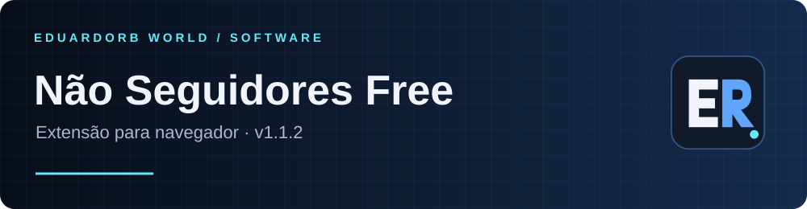

# EDUARDORB WORLD | Não Seguidores Free

Extensão gratuita para analisar e remover automaticamente não seguidores do Instagram, com base em exportações de dados. Não possui vínculo com a Meta.

O pacote fixo v1.1.2 ainda aparece no navegador como **Seguidores Locais**, seu nome anterior. A mudança de marca não altera o funcionamento do pacote.

## Download e instalação

[**Baixar pacote ZIP do repositório**](https://github.com/eduardorbworld/insta-auto-extension/archive/36d71e2f6ccd3a015b62435ec943cadaa1e36b24.zip) — versão 1.1.2, revisão fixa `36d71e2`.

1. Extraia o ZIP em uma pasta permanente.
2. Abra `chrome://extensions` no Chrome ou `brave://extensions` no Brave.
3. Ative o modo desenvolvedor e selecione **Carregar sem compactação**.
4. Escolha a pasta que contém diretamente o arquivo `manifest.json`.
5. Abra a extensão pelo menu de extensões do navegador.

**[Guia completo de instalação, atualização e solução de problemas](INSTALLATION.md)** · [Preparação de pacotes e checksums](PACKAGING.md)

## Recursos

- Comparação de seguidores e contas seguidas com base em exportações.
- Organização de perfis para revisão.
- Lista de proteção e armazenamento local.
- Controles de pausa e acompanhamento de progresso.

## Perguntas frequentes

**A extensão precisa da minha senha?** Não forneça sua senha à extensão nem compartilhe cookies ou tokens.

**Os resultados são em tempo real?** Não. A reciprocidade depende da exportação importada. Confira os dados e revise os perfis antes de qualquer ação.

**O navegador não encontra o manifesto?** Verifique se selecionou a pasta extraída correta, não o ZIP nem a pasta superior.

**Como atualizar?** Faça backup dos dados, preserve a pasta de instalação original e consulte as [notas da versão](LEIA-ME-v1.1.2.txt).

**Há risco para minha conta?** Sim. Ações automatizadas podem resultar em restrições ou suspensão. Respeite as regras do Instagram. Nenhuma cadência garante segurança.

## Suporte

[Página oficial do produto](https://eduardorbworld.github.io/eduardorbworld/seguidores-locais.html)

[Relatar problema ou sugerir melhoria](https://github.com/eduardorbworld/insta-auto-extension/issues).

Informe a versão da extensão, navegador, sistema operacional e descrição do problema. Nunca anexe dados de seguidores, cookies, credenciais ou backups pessoais.

## Privacidade, licença e limitações

- [Privacidade](PRIVACY.md)
- [Licença de uso gratuito](LICENSE)
- [Inventário preliminar de terceiros](THIRD_PARTY_NOTICES.md)
- [Notas da versão](LEIA-ME-v1.1.2.txt)

Uso gratuito e modificações para uso próprio; redistribuição e revenda não autorizadas são proibidas para componentes próprios, respeitadas as licenças de terceiros. O pacote é compilado. A auditoria integral de segurança e o inventário completo de dependências permanecem pendentes. O desenvolvedor relata teste prático bem-sucedido; não houve validação independente.

[Portfólio oficial — EDUARDORB WORLD](https://eduardorbworld.github.io/eduardorbworld/)
